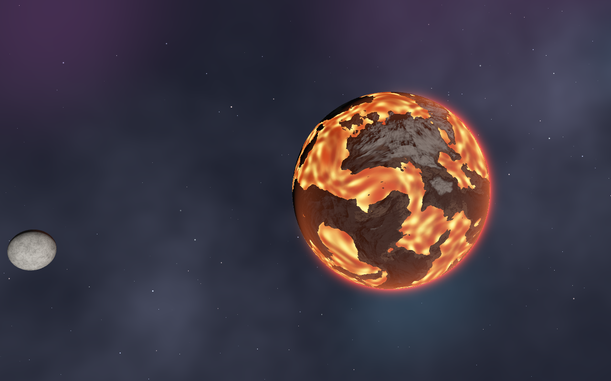
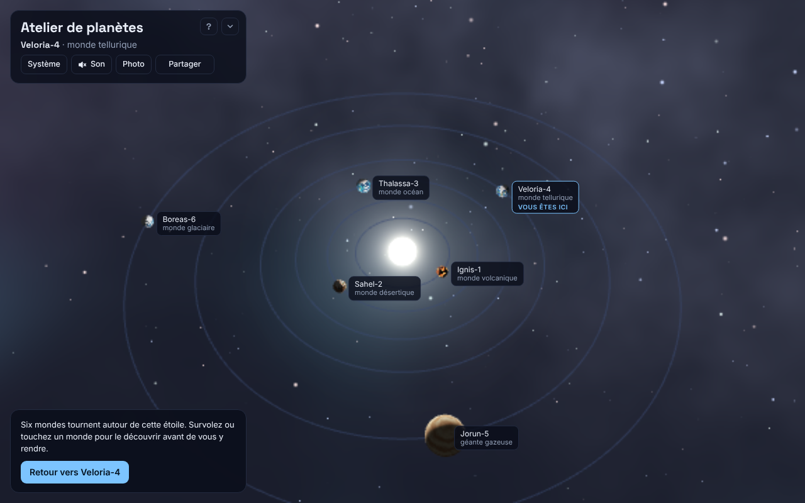
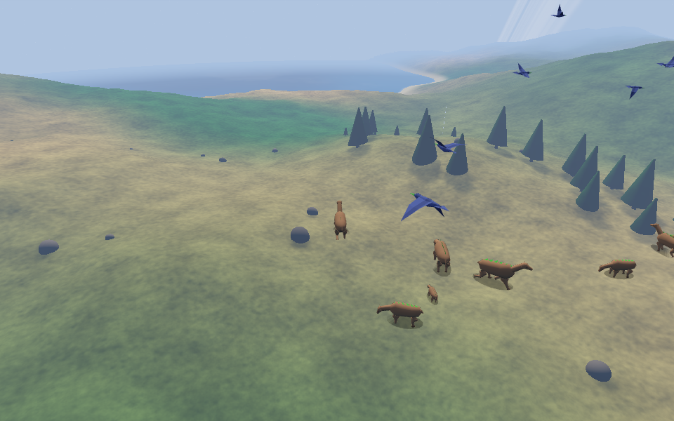

# Atelier de planètes

Une démo 3D qui tourne entièrement dans le navigateur : un système de six planètes générées par le code, que l'on peut façonner depuis l'orbite, puis explorer au sol à pied ou en vaisseau.

Aucune texture, aucun modèle 3D importé, aucun fichier son : le relief, le climat, les nuages, les anneaux, la faune et les sons sont calculés en direct.

Construit au fil d'une conversation avec Claude (Anthropic).

## Aperçu

| | |
|---|---|
|  Monde de lave |  Géante gazeuse |
|  Le système et ses six mondes |  Fin de la descente |
|  Au sol, à pied |  En vaisseau |

Ces captures viennent de `index.html`, sans retouche. Elles ont été prises avec un rendu logiciel (sans carte graphique) : sur une vraie machine, l'image est la même mais fluide.

## Lancer la démo

Ouvrez `index.html` dans un navigateur récent (Chrome, Edge, Firefox, Safari), avec l'accélération matérielle activée. Une connexion est nécessaire au premier chargement : la page récupère three.js (r128) et deux polices depuis un CDN.

Pour la mettre en ligne, activez GitHub Pages sur la branche principale : `index.html` est à la racine.

## Ce qu'on peut faire

- **En orbite :** choisir un type de monde (tellurique, océan, désert, glace, lave, géante gazeuse), régler niveau des mers, température, nuages, atmosphère et anneaux, ou tirer une planète au hasard.
- **Se poser :** bouton « Se poser » (plaine tempérée la plus proche) ou double-clic sur un lieu précis. La descente traverse les nuages sans coupure.
- **Au sol :** marcher (flèches ou ZQSD/WASD, Maj pour courir) ou piloter le vaisseau. Le terrain est celui vu depuis l'orbite ; le soleil, les anneaux et les lunes sont à leur vraie place dans le ciel.
- **Faune :** chaque planète tire ses espèces de sa graine : troupeaux, prédateurs, volants, bancs marins et un géant des profondeurs.
- **Système :** voyager entre les six mondes autour de l'étoile.
- **Partage :** « Partager » produit un code qui recrée exactement une planète ; « Photo » masque l'interface.

## Fichiers

| Fichier | Contenu |
|---|---|
| `index.html` | La démo complète, en un seul fichier |
| `ile-au-phare.html` | La première démo de la série : une île générée, avec phare, forêt et cycle jour/nuit |
| `VIDEO-LINKEDIN.md` | Script de vidéo et texte de post pour présenter la démo sur LinkedIn |
| `docs/` | Captures d'écran utilisées dans ce README |

## Comment ça marche, en bref

- **Vue d'orbite :** une sphère dont chaque pixel est calculé par un shader (bruit fractal pour les continents, climat par latitude et altitude, ombres des lunes et des anneaux calculées géométriquement).
- **Vue du sol :** un lancer de rayons sur un champ de hauteur. Le relief à grande échelle est échantillonné dans la fonction de hauteur de la planète autour du site d'atterrissage, puis du détail fin est ajouté. La zone se recentre sous le joueur, ce qui permet de traverser toute la planète.
- **Faune et vaisseau :** des maillages three.js dessinés par-dessus, masqués par le relief grâce à la profondeur écrite par le lancer de rayons.
- **Son :** synthèse Web Audio (bruit filtré et oscillateurs).

## Limites connues

- La vue du sol est exigeante pour la carte graphique ; la résolution baisse automatiquement si l'appareil peine.
- Le son, la navigation tactile et plusieurs mondes (lave, glace, désert) ont été peu testés.
- Les chasses des prédateurs n'aboutissent jamais : la proie s'échappe toujours.
